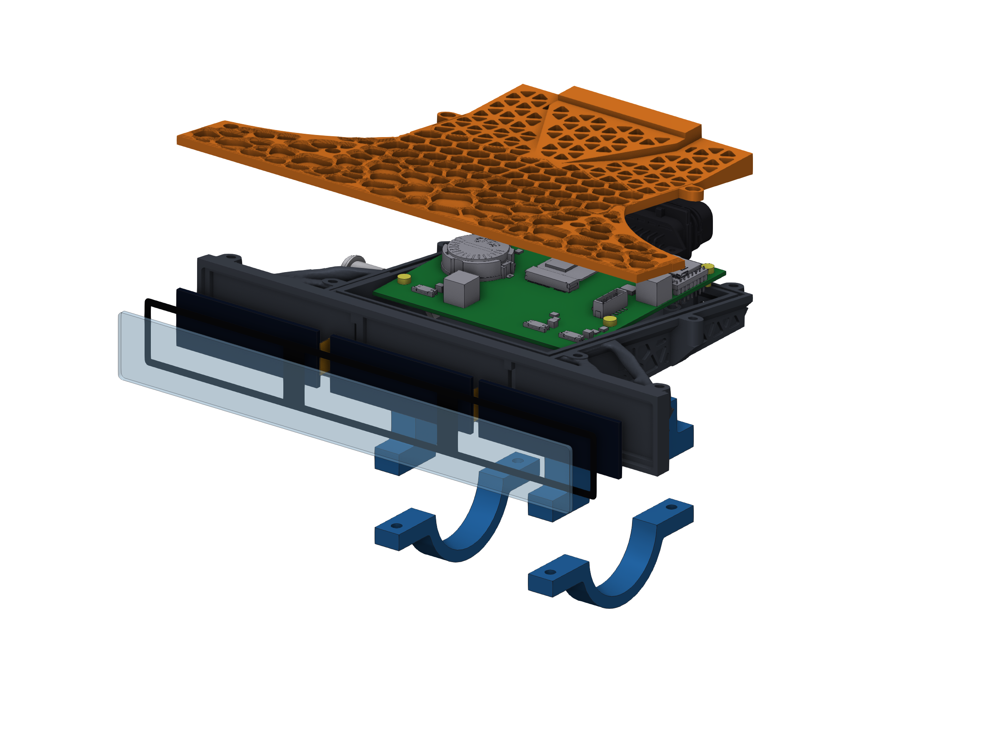
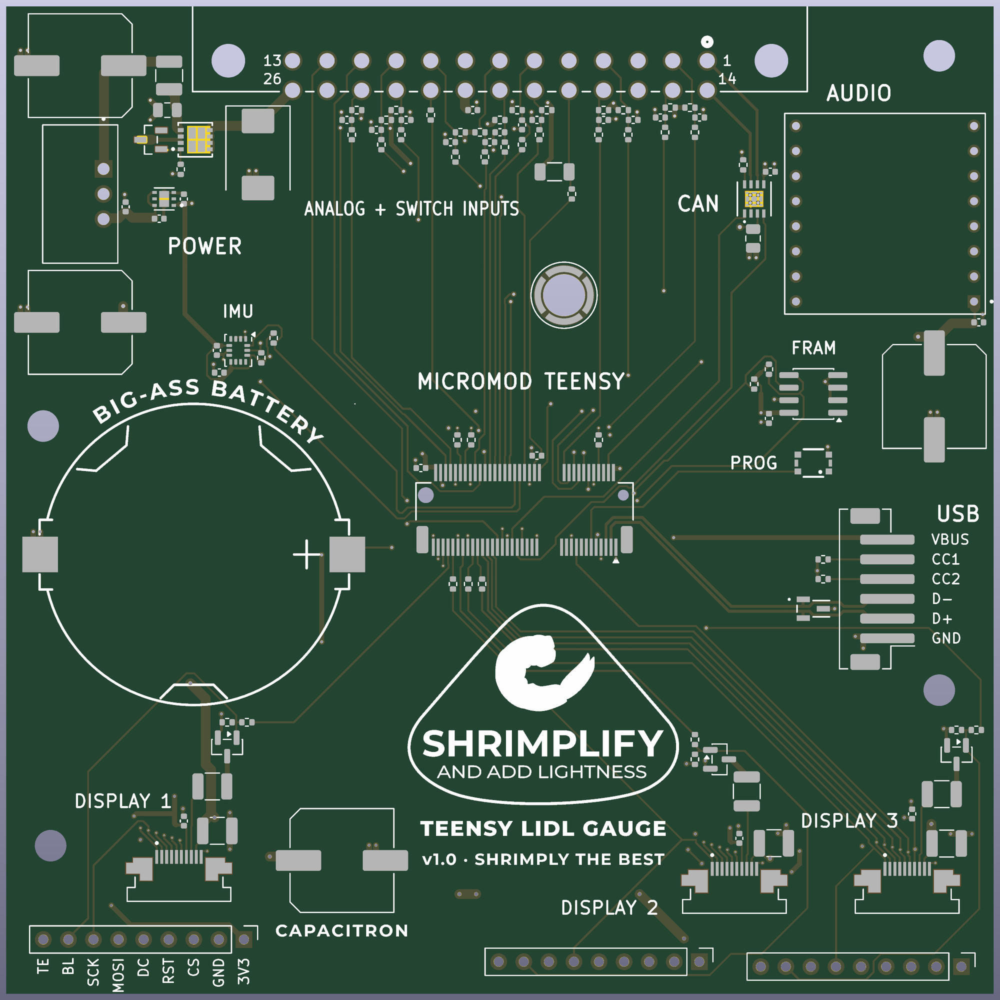
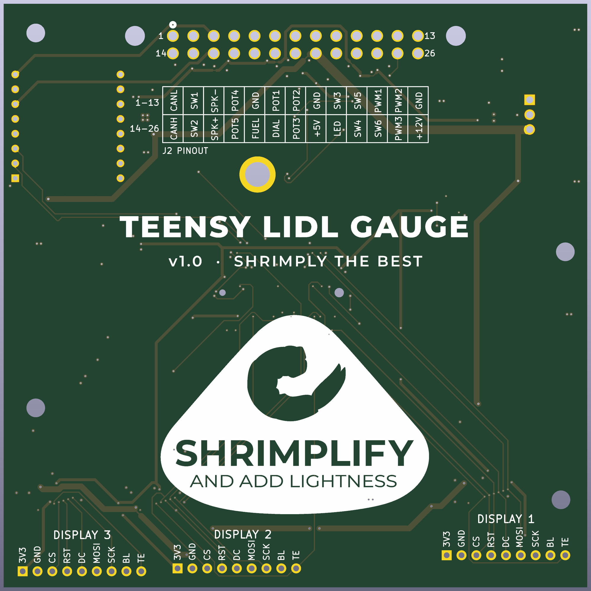
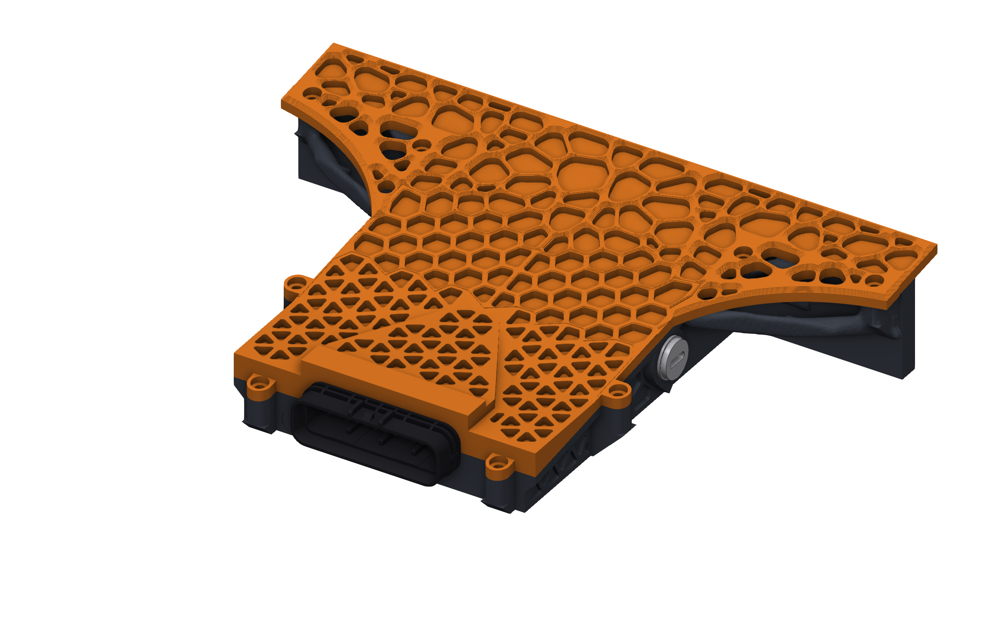
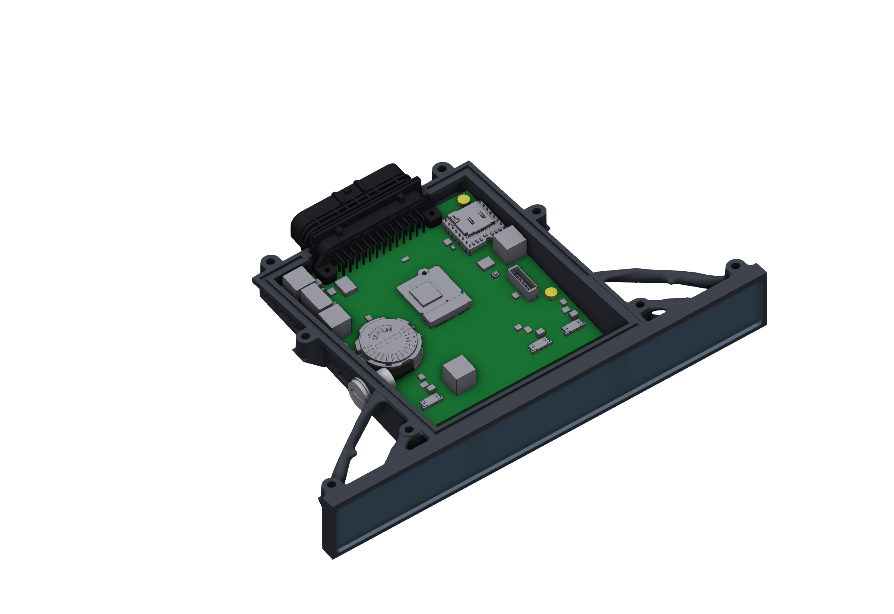
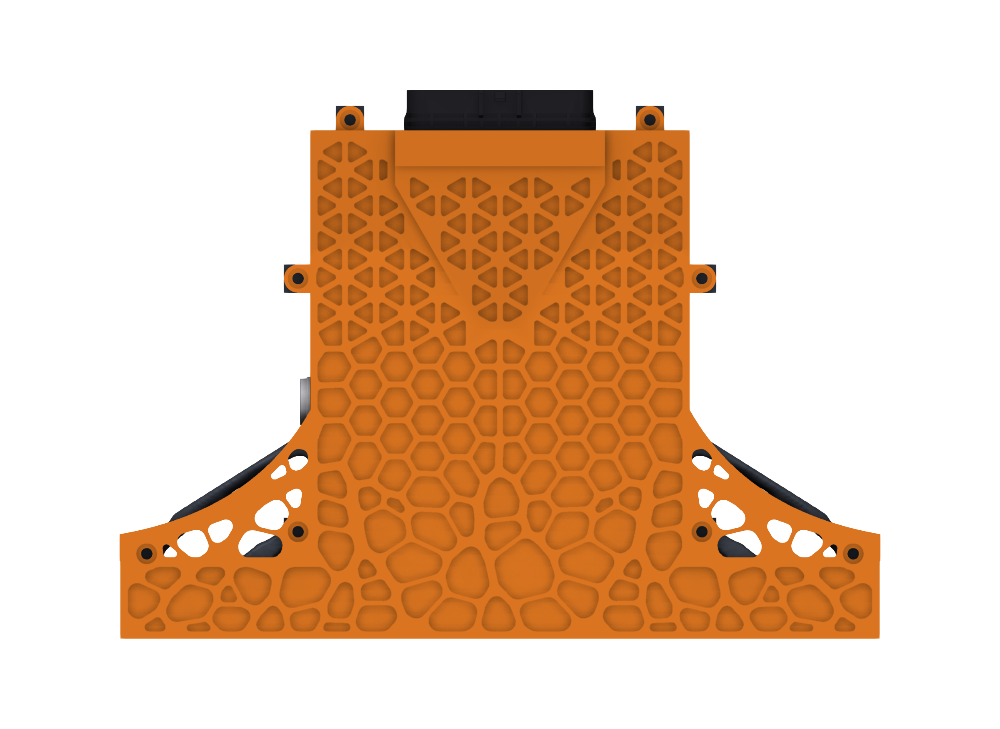
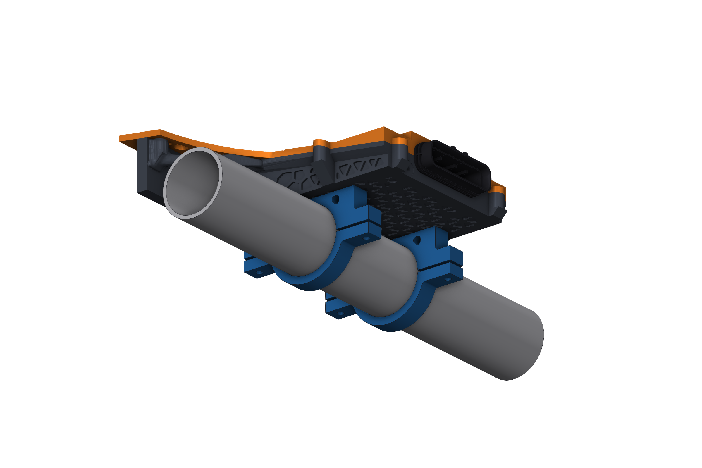

# Teensy Lidl Gauge

This is a set of gauges for my BMW E30 rally car, designed to be viewed in the peripheral vision, alerting to situations that need attention or immediate action and otherwise mostly being ignored while my OODA loop focuses on the stage ahead.

  

Three ER-TFT2.79-1 bar displays (NV3007 controller), driven over SPI by a
SparkFun MicroMod Teensy (it replaced the Teensy 4.0 in Nov 2026; the rev 2
PCB then moved 31 of the 46 pins - the map is at the top of `src/config.h`),
fed by CAN data from the rusEFI ECU (a Super uaEFI), the JK BMS and the
car's two dingoFW PDMs. The gauge also reads the roof switch panel (six
switches, five pots) and sends it to the PDMs over CAN - it is the car's
light-switch node - and drives three PWM speed signals for the cabin fans.

This repository holds the firmware (`src/`, `lib/`, `docs/`) and, in
[`hardware/`](hardware/), the KiCad project, fab outputs and the 3D-printed
enclosure. The full hardware/software plan (`Rally CAN Gauge Project Plan`)
lives outside this repository.

**Status (Nov 2026):** the v1.0 board is at the ordering stage.

## Design philosophy

- Most of the time the right amount of attention to pay the gauge is none. 
-  Red: The car is about to blow up.
  Yellow: Start worrying, keep an eye on it. Blue: information. A one-line
  banner names the problem (`OIL LOW`, `PUMP FLT`), critical banners flash
  at 1 Hz, and  have GPWS-style voice callouts
- Input code establishes what is (temperatures, pressures, link freshness); one alarm table decides what
  matters; the screens, LEDs and audio only render its verdicts. No
  display code ever touches a threshold. 
- A dead sensor or a dropped CAN link draws as
  `--`. Stale data raises no alarms of its own.
- The rotary dial is the only control: bright,
- medium, dark (night colours turn every blue element amber, which is kinder
  to dark-adapted eyes), debug, silent, fuel fill and displays off.
- All vehicle I/O comes through one sealed 26-pin Superseal. The 12 V front end has reverse-polarity protection, a
  36 V TVS, a switching 5 V module and a separate 3.3 V LDO. The fuel
  record (in CRC'd rotating slots) and a black-box log live in F-RAM, a hardware watchdog resets hung
  firmware within a second. 

## Hardware

  
  

100 x 100 mm, four layers (Signal / GND / GND / Signal), 1.6 mm, laid out in
KiCad 10 against JLCPCB's rules and their JLC04161H-7628 stackup. The J2 pin-out is printed on the back of the board.

| Block | Parts |
|---|---|
| Processor | SparkFun MicroMod Teensy in a TE 2199230-4 M.2 (E-key) socket |
| Displays | 3x ER-TFT2.79-1 on 10-pin 0.5 mm FPC connectors (Amphenol SFV10R-2STE1HLF), one SPI bus each; PWM backlights through three low-side N-FETs |
| Vehicle connector | TE Superseal 1.0, 26-pin (6473711-1): +12 V, CAN, six switch inputs, five pots, fuel sender, rotary dial, speaker, LED-strip data and 5 V, three fan PWM outputs |
| CAN | TI TCAN1051HGV-Q1 |
| Power | Traco TSR 3-2450N (5 V, 3 A), TI TLV75733P (3.3 V LDO), Panjit PJQ4465AP reverse-polarity P-FET, SMCJ36CA TVS |
| Logging and sensors | 1 Mbit I2C F-RAM (FM24VN10 / FM24V10), ST LSM6DSV320X IMU (±320 g), CR2450 cell for the clock |
| Audio | DFRobot DFPlayer Mini (DFR0299)|
| USB | 6-pin JST-PH (J1) to an Adafruit 6153 panel-mount USB-C, TPD2E2U06 ESD protection |

### What is in `hardware/`

| Path | What |
|---|---|
| `TeensyLidlGauge.kicad_pro`, `.kicad_pcb`, `.kicad_dru` and eight `.kicad_sch` sheets | KiCad 10 project: schematic, routed board, custom design rules |
| `Library.pretty/`, `Parts/`, `3dmodels/` | the footprints, symbols and 3D models made for this project, at the project-relative paths the design expects (third-party library files are left out; see below) |
| `Gerb/` | Gerbers and drill files, plus `TeensyLidlGauge-Gerb.zip` ready to upload |
| `BOM/` | `JLCPCB_BOM_upload.csv` (LCSC part numbers) and `Pikkolo_BOM_upload.csv` (MPNs and distributor part numbers) |
| `place/` | pick-and-place: `TeensyLidlGauge-JLC-CPL.csv` (JLCPCB format) and `TeensyLidlGauge-all-pos.csv` (KiCad format) |
| `Enclosure/` | printable STLs, a STEP fit-check assembly, renders |
| `renders/` | the PCB renders above |

Ordering notes:

- Left off both BOMs on purpose: J3 to J5 (9-pin display breakout headers,
  do not populate) and H2 to H5 (M3 mounting holes).

### Third-party library files

Some symbols, footprints and 3D models came from SnapEDA, Ultra Librarian,
LCSC/EasyEDA or the part makers, whose terms allow sharing a board design
built with them but not re-uploading the library files themselves. Those
files are not in this repository. Every footprint and symbol is still
embedded in the `.kicad_pcb` and the schematic, so the project opens,
checks and plots without them. KiCad may warn that the library copies are
missing, and the 3D viewer shows these parts without bodies. For the full
3D view, download the models by part number and save them at the paths
given in each footprint's 3D model settings (most are under `Parts/`).

| Ref | Part | Not included |
|---|---|---|
| U1 | TI TCAN1051HGVDRBRQ1 | footprint, symbol, 3D model |
| U2 | TI TLV75733PDRVR | footprint, symbol, 3D model |
| U3 | ST LSM6DSV320XTR | symbol |
| U4 | TE 2199230-4 (M.2 socket) | 3D model |
| U5 | TI TPD2E2U06QDBZRQ1 | footprint, symbol, 3D model |
| U7 | DFRobot DFR0299 | footprint, symbol, 3D model |
| Q2 | Panjit PJQ4465AP-AU_R2_000A1 | footprint, symbol |
| D1 | onsemi SZBZX84C16LT1G | footprint, symbol, 3D model |
| CR1 | Littelfuse SMCJ36CA | symbol |
| PS1 | Traco TSR 3-2450N | footprint, symbol, 3D model |
| S1 | Würth 435171014816 | footprint, symbol, 3D model |
| BT1 | MYOUNG BS-24-B4AK014 | footprint, symbol, 3D model |
| J1 | JST B6B-PH-SM4-TB | symbol |
| J2 | TE 6473711-1 (Superseal) | footprint, 3D model |
| J6 to J8 | Amphenol SFV10R-2STE1HLF | footprint, symbol, 3D model |

### Enclosure

  
  

  
  

*Shrimplify, and add lightness.*

| File | What |
|---|---|
| `tray_R2_b2.stl` | tray: holds the PCB and the display bar |
| `cover_R2_bloom.stl` | patterned cover |
| `clamp_saddle_1p75in.stl`, `clamp_cap_1p75in.stl` | dash-bar clamp halves for a 1.75 in tube (the renders use two clamps) |
| `assembly_R2_reference.step` | fit-check assembly with the PCB, lens and mask, USB-C, clamps and a 1.75 in bar (it uses unpatterned versions of the tray and cover) |

## Firmware layout

- `src/main.cpp` - the superloop (scheduler + 1 Hz debug print).
- `src/config.h` - every pin, constant, threshold and tunable in one place.
- `src/vehicle_data.h/.cpp` - the central data model (`g_data`), including
  the alarm catalog enum (ordered by the plan's priorities).
- `src/alarms.h/.cpp` - the warning/alarm state machine: one table row per
  alarm (name, color, tier, persistence, audio clip, condition), 36 rows in
  priority order. The PDM rows class a fault by what it costs (engine,
  cooling, vision, body) and name the load on the banner (`PUMP FLT`).
- `src/led_tach.h/.cpp` - the WS2812 strip: 3 status LEDs, the 12-LED tach
  and shift light, plus the switch-label backlights wired onto the end of
  the same chain (one steady color, never part of the flashing).
- `src/audio.h/.cpp` - voice-callout arbitration (priority, repeat intervals,
  no talking over itself) plus the DFPlayer Mini driver (Makuna/DFMiniMp3 on
  Serial7, pins 28/29, watchdog-safe NoAck mode - design notes at the top
  of the .cpp).
  SD card layout is documented on the clip enum in `audio.h`; the rotary
  dial's silent position (`MODE_SILENT`) mutes all callouts.
- `src/backlight.h/.cpp` - display backlight dimming: 20 kHz PWM into three
  low-side N-FET switches (pins 9/33/4 - all on FlexPWM2 so the three
  windows can be locked a third of a period apart: the 5V rail sees one
  100 mA step at a time instead of 300 mA), brightness from the rotary mode
  with per-screen binning trim (`BL_TRIM`) and a 250 ms fade between
  levels. Hardware, frequency and phase rationale in `config.h`; the
  FlexPWM register mechanics and the bench check at the top of the .cpp.
- `src/watchdog.h/.cpp` - minimal register driver for the i.MX RT's WDOG1.
- `src/can_bus.h/.cpp` - CAN3 + the decoders: rusEFI's native broadcast
  (frames BASE0..7, layouts from rusEFI's own DBC), the one target-AFR byte
  from rusEFI's MS Simplified broadcast, the JK BMS Deye protocol (1 Hz)
  and both PDMs' dingoFW status frames (10 Hz, driven by the `PDM_FRAMES`
  table in `config.h`) - all little-endian. It transmits the 1 Hz PCS
  heartbeat the BMS expects from an "inverter" and the two frames that
  carry the roof switches and pots to the PDMs (10 Hz + on change; every
  switch is sent as an on bit and an off bit so the PDM config can make
  lamps fail ON). Every frame is counted as decoded, ignored (expected
  traffic we don't use) or unknown, so a misconfigured bus shows up as
  `unk=`.
- `src/pdm.h/.cpp` - what the PDM status means: a verdict per output (OK /
  TRP tripped / OPN open load / FLT faulted or stuck) with the memory those
  need, the lamp states the indicator icons and night mode read, and the
  last output event for the black box. Rules and the dingoFW behaviour they
  rest on at the top of the .cpp.
- `src/fans.h/.cpp` - three 25 kHz PWM speed signals for the defrost and
  seat fans, each set by a roof-panel pot.
- `src/mixture.h/.cpp` - the gated two-second lambda window the AFR alarms
  judge: samples only count while the driver is on the throttle, rusEFI
  isn't cutting fuel, and the sensor has recovered from the last time that
  wasn't true - so overrun and fuel cut can't raise AFR LEAN.
- `src/inputs.h/.cpp` - fuel sender (ratiometric 150R divider, including
  the two-stage slosh filter: median window + slow EMA), rotary switch
  (4.7k pull-up into eleven resistors chosen for even voltage steps, decoded
  by nearest expected ratio, with open-wiper detection feeding the DIALFAIL
  alarm and a fail-safe fallback to Bright), the roof panel's six
  ground-switched switches (debounced) and five pots (rheostats, percent of
  travel, open-wire failsafe), chip temp, RTC. The circuits are drawn in
  `config.h`.
- `src/fuel_calc.h/.cpp` - calculated fuel: integrates the ECU's injector
  pulse width (dead-time corrected) into a gallons-remaining estimate, and
  runs the rotary FUEL FILL gesture (hold 30 s = +5 gal, 60 s = full tank).
  Physics and design rationale at the top of the .cpp; constants in
  `config.h`. Seeds from the FRAM fuel record at boot (sender fallback).
- `src/fram.h/.cpp` - FM24V10 F-RAM driver: non-blocking I2C write queue
  (interrupt-driven via teensy4_i2c - the superloop never waits on the
  bus), blocking reads for boot/console, shared CRC-16.
- `src/fram_log.h/.cpp` - what the FRAM stores: the persistent fuel record
  (16 rotating CRC'd slots - kill-switch-proof) and the black-box flight
  recorder (~1.8 h circular log of every gauge field, PDM temperatures and
  output events, roof switches + active alarms), plus
  the serial console (`h` in the monitor: CSV dump, fuel slots, format).
  **See `docs/FRAM_BLACKBOX.md`** for the memory map, record formats,
  wiring, and how to read the log out.
- `src/gauge_render.h/.cpp` - what the three panels show: the bench-tested
  prototype layouts (big value left, secondary stack right), the semantic
  color Theme (night mode = every blue element turns amber, resolved in one
  place), per-readout coloring from alarm verdicts, the warning banner with
  its 1 Hz critical flash, and the MODE_DEBUG dense pages. Stateless: every
  frame is composed from scratch from g_data ("compose then show", like the
  LED strip). Design story at the top of the .cpp.
- `src/screens.h/.cpp` - how frames reach the glass: three ILI9341_T4
  drivers (one per SPI bus), one shared 121 KB draw buffer + three
  per-display internal buffers in OCRAM, differential DMA updates, the
  busy-skip rule that keeps the superloop from ever blocking on a transfer,
  and displays-off handling. Memory map + pipeline at the top of the .cpp.
- `src/fonts/` - the custom Iosevka faces (tgx font exports, PROGMEM):
  Regular 30 px for labels, Heavy 30 px for the banner, Extended 55/114 px
  for values. Monospaced so a changing digit dirties only its own cell
  (small diffs). Regenerate with vindar's tgx font tool from the Iosevka
  TTFs; the PC prototype (the local `Graphics/` folder, not in this
  repository) is the layout source of truth.
- `src/examples/display_bringup.cpp` - display test pattern, built by the
  `display_test` environment (wiring documented at the top of the file).
- `docs/FRAM_BLACKBOX.md` - the FM24V10 wiring, memory map, record
  formats, black-box gating rules, and the serial console commands.
- `docs/ECU_CAN_SETUP.md` - **the rusEFI / TunerStudio settings the firmware
  expects** (broadcast base address, dash type, period), the frame map, and
  the bring-up checklist. Keep it in sync with `config.h`/`can_bus.cpp`.
- `docs/BMS_CAN_SETUP.md` - the JK BMS protocol selection (Deye/001), the
  frames decoded, BMS bring-up checks, and the table of every CAN id on the
  bus.
- `docs/PDM_CAN_SETUP.md` - **the dingoConfig settings the firmware
  expects**: Base IDs, the status frames decoded (including the proposed
  frames for outputs 9-14), the two frames the gauge sends, the CAN-input
  recipe that makes lamps fail on, and the bench checks.
- `lib/ILI9341_T4/` - vindar's ILI9341_T4 DMA display library, modified for
  the NV3007 controller. **Read `lib/ILI9341_T4/PORTING_NV3007.md`** for a
  walkthrough of every change and why it was needed. It is vendored from
  upstream v1.7.1 (commit `bee2957`, https://github.com/vindar/ILI9341_T4);
  diff against that commit to see the exact modifications.

## Display driving in one paragraph

Each display gets its own SPI bus (display 1 on SPI2, display 2 on SPI1,
display 3 on SPI). We draw into a
428x142 RGB565 framebuffer in RAM, then `tft.update(fb)` hands it to the
library, which diffs it against what is already on screen and streams only
the changed pixels out via DMA - the CPU is free almost the entire time.
VSync is not available (the display has no MISO line to poll the scanline),
but the TE pin is broken out on the module and reserved in the pinout for a
possible future tear-free sync mod.
