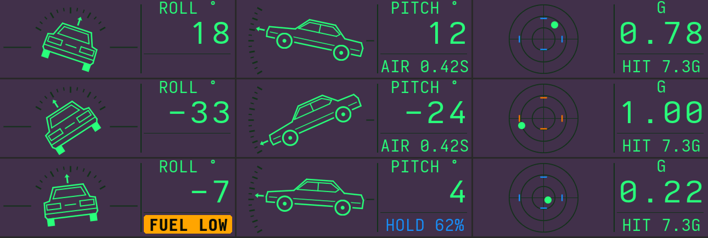

# IMU: g, attitude, jumps and impact captures

The gauge carries an ST **LSM6DSV320X** (U3): a ±16 g accelerometer, a
gyroscope, and a second accelerometer that reads to **±320 g**. The firmware
does four things with it:

1. **Broadcasts it on CAN**, on ids that lose arbitration to everything else
   on the bus. A Lua script on the ECU puts eight values in rusEFI's SD card
   log.
2. **Captures hard hits to the FRAM**: five seconds of high-g waveform around
   each one, written while it happens. See `FRAM_BLACKBOX.md`.
3. **Adds g to the black box**: every record carries the average lon/lat g
   and the hardest hit since the previous record.
4. **Draws an inclinometer**: an E30 rolling and pitching, and a g-meter, on
   dial position 7.

Code: `src/imu.h/.cpp` (the chip), `src/motion.h/.cpp` (what the samples
mean), `src/fram_events.h/.cpp` (the captures), the IMU section of
`src/config.h` (every number below), `docs/rusefi_imu.lua` (the ECU side),
`test/host/` (the PC-side tests).

**Status, Nov 2026: none of this has run on hardware.** The board is not
built. What has been checked: the firmware compiles for the MicroMod Teensy;
the register addresses, bit positions and sensitivities are from ST's own
driver source and the datasheet (DS14623 rev 3); the motion maths, the
capture store and the black-box changes pass a PC test harness that feeds
the real code synthetic sensor data; the Lua script runs in Lua 5.4 against
frames packed the way the firmware packs them; the screens were rendered on
a PC with the real drawing code. What has not: anything involving the actual
chip, the I2C bus, or a car. The bench checklist at the end is the list of
things to prove first.

## Sign conventions

One set, used on the screens, on CAN, in both logs:

| Value | Positive means |
|---|---|
| lon g | speeding up (braking is negative) |
| lat g | turning left |
| vert g | pressed into the seat: **1.0 parked**, 0 in free fall |
| roll | right side down |
| pitch | nose up |
| yaw rate | turning left |

Accelerations are what an accelerometer feels, gravity included. Parked on a
10° uphill the car reads lon +0.17 g. That is how every g-meter behaves, and
it keeps the logged values unambiguous.

## How the samples are taken

INT1 and INT2 are not routed on this board, so nothing can tell the Teensy a
sample is ready. Instead the chip samples on its own clock into its FIFO
(high-g at 960 Hz, low-g and gyro at 120 Hz) and the driver empties the FIFO
every 5 ms over I2C (LPI2C2, pins 41/40, 1 MHz), without blocking the
superloop. Nothing between two looks is missed.

Three datasheet numbers shape the processing:

- The high-g channel's zero is only good to **±1.5 g** (typical). The low-g
  channel's is ±12 mg. So the firmware continuously measures the difference
  between the two and subtracts it from the high-g channel (`hgTrim` on the
  debug line). Trimmed, the high-g channel reads 1.00 g at rest.
- The high-g channel's noise is 1 mg/√Hz, roughly 20 mg rms at this rate.
  Fine for impacts; angles and the g-meter use the low-g channel.
- The FIFO holds 1.5 KB, about 250 samples: 0.2 s at these rates. A stall
  longer than that loses samples and counts an overrun (`ovr=`).

## Mounting: the axis map

`IMU_AXIS_FORWARD / LEFT / UP` in `config.h` say which sensor axis points
which way in the car. The defaults come from the datasheet's figure 5 and
the PCB (U3 is on the front copper, rotated −90°), assuming the board lies
flat, front side up, with J2 toward the front of the car and the displays
toward the driver, as the enclosure renders show:

    forward = −X      left = −Y      up = +Z

**Check it on the bench before anything else** (see the checklist). If the
gauge ends up mounted another way round (under the bar, for instance),
change the three entries; they must form a right-handed set, and the
firmware complains at boot if they do not.

The map only has to be right to the nearest axis. The exact angle is taken
out by the level set.

## LEVEL SET (dial position 8)

The gauge clamps to a round bar, so it sits at whatever angle the clamps
were tightened at. To zero it:

1. Park on level ground, **engine off**.
2. Turn the dial to position 8. The screens show the inclinometer pages.
3. Keep the car still. The pitch screen counts `HOLD 0%` to `100%` over
   5 seconds, then shows `LEVEL SET`. If anything moves it shows
   `HOLD STILL` and starts again.

The result is stored in the FRAM and survives power cycles. Until it has
been done the roll screen says `NOT LEVEL` and roll/pitch include the
mounting angle. Redo it whenever the gauge has been moved on its bar.

Arriving on position 8 also **resets the g-meter's maxima** and the `HIT`
readout, whether or not a level set follows.

A chip format (`X`, `Y` on the console, or a layout-version change) erases
the level calibration along with everything else.

## The inclinometer (dial position 7)

<p align="center">
  
</p>

*Drawn by the firmware's own rendering code on a PC (`test/host/run.sh
render`), not photographed. Top: day. Middle: night colours. Bottom: a level
set in progress with a warning up.*

| Screen | Shows |
|---|---|
| 1 | **ROLL**: the E30 from behind against a 10°-per-tick scale, and the angle. The warning banner still appears here. |
| 2 | **PITCH**: the E30 from the side (facing left) against a 5°-per-tick scale, and the angle. Below it, the last jump's air time. |
| 3 | **G**: a g-meter. The dot goes where a loose ball on the dash would roll (forward under braking, right in a left-hander). Rings at 0.5, 1.0 and 1.5 g; the four small marks are the maxima. The number is the combined lon/lat g; `HIT` is the hardest impact since the maxima were reset. |

How good the angles are: roll and pitch are the gyroscope integrated, pulled
slowly (3 s) toward where the accelerometer says up is, but only while the
total acceleration is within 0.1 g of 1 g. Parked or crawling they are good
to about a degree. At stage pace the accelerometer is rarely trustworthy and
gentle sustained cornering still leaks in, so expect errors of several
degrees. That is a limit of estimating attitude without a speed signal, not
a tuning problem. (A mechanical clinometer swings with every corner too.)

LEDs, audio and the banner work as in any other mode.

## CAN frames

500 kbps, 11-bit ids, little-endian, 8 bytes. `IMU_CAN_BASE_ID` = **0x6A0**.

**Why these ids.** CAN arbitration goes to the lower id. 0x6A0-0x6A3 is above
every id that matters here: the BMS's live frames, the wideband (0x190), both
PDMs (0x440-0x4BF), the gauge's switch frames (0x4C0), the MS dash frames
(0x5E8) and the ECU's broadcast (0x680-0x68B). When any of those wants the
wire at the same moment, the IMU frame waits. Only the BMS's 1 Hz
version/serial/statistics frames (0x700, 0x750) rank lower. A frame already
on the wire is never interrupted, so the worst an IMU frame can do to
anything is delay it by one frame time, under 0.3 ms.

| Id | Every | Bytes | Content | Scale |
|---|---|---|---|---|
| 0x6A0 impact | 40 ms | 0-1 | largest total acceleration of the last 0.2 s (uint16) | 0.01 g |
| | | 2-3, 4-5, 6-7 | lon, lat, vert: per axis the reading of largest size in the same 0.2 s, signed (int16) | 0.01 g |
| 0x6A1 motion | 40 ms | 0-1, 2-3, 4-5 | lon, lat, vert: low-g channel, smoothed 0.1 s (int16) | 0.001 g |
| | | 6-7 | yaw rate (int16) | 0.1 °/s |
| 0x6A2 attitude | 100 ms | 0-1, 2-3 | roll, pitch (int16) | 0.1 ° |
| | | 4-5 | air time of the last jump (uint16) | 1 ms |
| | | 6 | jumps since boot (wraps) | 1 |
| | | 7 | status bits, below | |
| 0x6A3 event | 200 ms | 0-1 | number of the latest impact capture, 0 = none (uint16) | 1 |
| | | 2-3 | its peak total acceleration (uint16) | 0.01 g |
| | | 4-5 | its delta-v, all axes combined (uint16) | 0.01 m/s |
| | | 6-7 | landing of the last jump, total acceleration (uint16) | 0.01 g |

Status bits (0x6A2 byte 7): bit 0 IMU data live, 1 level-calibrated, 2
high-g trim settled, 3 airborne now, 4 a capture is recording, 5 standing
still, 6 samples have been lost since boot.

When the IMU is not delivering, the frames are still sent with zeros and
status bit 0 clear. A total of 0.00 g in the impact frame is the tell: a
working sensor at rest reads 1.00.

**Why the impact frame is peak-held.** A landing lasts milliseconds; a logger
samples every 10 to 50 ms and would mostly miss it. The gauge samples at
960 Hz and sends the largest reading of the last 0.2 s, so each hit is on
the bus in at least three consecutive frames at its full height. The cost is
0.2 s of smear in *when*. For timing to the millisecond, read the capture
from the FRAM.

Bus load: 65 frames a second, about 1.6 % of the bus.

## Getting it into the rusEFI SD log

rusEFI has eight "Lua gauges": values a Lua script sets, which the ECU logs
to its SD card like any other channel. `docs/rusefi_imu.lua` listens for the
frames above and fills all eight:

| Log channel | Value | Unit |
|---|---|---|
| Lua: Gauge 1 | PeakG, hardest total acceleration of the last 0.2 s | g |
| Lua: Gauge 2, 3, 4 | PeakLon, PeakLat, PeakVert | g |
| Lua: Gauge 5, 6 | Roll, Pitch | ° |
| Lua: Gauge 7 | AirTime of the last jump | s |
| Lua: Gauge 8 | Impact: the gauge's capture number, steps at each captured hit | |

Setup:

1. Paste `docs/rusefi_imu.lua` into TunerStudio's Lua Script dialog and
   burn. It only listens; it never transmits.
2. Set the SD card log rate (`sdCardLogFrequency`, 1 to 250 Hz) to
   **10 Hz or more**. Below that a hit can fall between two log lines.
3. Check: with the gauge on the bus and the car parked, the four peak
   gauges read 1, 0, 0, 1. Rap the gauge with a knuckle and gauge 1 jumps
   for a fifth of a second.

The three per-axis peak channels take the largest reading in each 0.2 s, so
they ride on top of whatever vibration there is; on a smooth road that is
within about 0.1 g of the true lon/lat/vert, close enough to double as
g-meter channels. To log the smoothed low-g values, yaw rate, jump count, landing g or the
capture's peak and delta-v instead, edit the `setLuaGauge` lines: the script
has a handler for every frame. Eight is all rusEFI offers.

Facts this rests on, read from rusEFI's source (master, Nov 2026):
`LUA_GAUGE_COUNT` is 8 and the gauges are output channels named
"Lua: Gauge"; `canRxAdd(id, callback)` and `setLuaGauge(index, value)` in
`controllers/lua/lua_hooks.cpp`; the Super uaEFI is an STM32F7 build with
room for 256 buffered Lua CAN frames and a 25000-character script.

Two alternatives that were considered and not used:

- **Emulating a Bosch MM5.10 yaw sensor**, which rusEFI decodes natively into
  its own acceleration channels with no script. Its ids are fixed at
  0x174/0x178/0x17C, which would outrank the ECU's own broadcast on this
  bus, and its encoding stops at ±4.2 g.
- **Sending raw 960 Hz samples.** About a quarter of the bus, and the ECU's
  log could not keep them anyway.

Worth knowing: rusEFI's board file for the Super uaEFI initialises an
accelerometer on the ECU's own module. If it is fitted and working, the ECU
log already has low-g lat/lon/vert channels of its own, in the ECU's axes.
This was read from the source, not checked on a board; look for the
acceleration gauges in TunerStudio.

## Jumps

Airborne means the total acceleration stays under 0.35 g (`IMU_AIR_G`): free
fall reads zero. At least 150 ms of that is a jump; shorter is a crest. The
landing is the hardest hit in the 0.5 s after the wheels come back. The last
jump's air time and landing go out on CAN, and a capture triggered by a
landing records the air time in its header.

All three numbers are starting guesses. Tune them from the first log.

## Impact captures

A capture starts when the trimmed high-g total stays at or above
**6 g** (`IMU_EVENT_TRIGGER_G`) for two samples in a row. It keeps 1 s from
before the trigger and 4 s after.

**The 6 g is a guess.** Nobody has measured what this dash bar sees on a
stage, and the gauge measures the bar it is clamped to, bracket resonances
included, not the car's centre of gravity. Run a stage, look at
`Lua: Gauge 1` in the SD log, and set the trigger so that it fires a handful
of times a stage. Setting it too low costs little: the two hardest hits on
the chip are never overwritten.

Each capture's header carries the exact peak (total and per axis), the time
spent above the trigger level, the air time if it was a landing, rpm and
throttle at the trigger, the RTC time, and **delta-v**: the change in the
car's velocity, per axis, in m/s. Delta-v is the acceleration with gravity
taken out, summed while the total is above 2 g. It is the usual measure of
how hard a crash was, and it does not depend on catching a single peak
sample.

Reading them out, on the serial console (`pio device monitor`, 115200):

- `e` lists the captures.
- `E` dumps the waveforms as CSV: one row per 4.2 ms with lon, lat and vert g
  and the roll, pitch and yaw rate. Time zero is the trigger.
- `C` then `Y` clears them. Do this after reading out a crash: the two
  hardest hits stay on the chip until cleared.

The format, the slot rules and what a power loss costs are in
`FRAM_BLACKBOX.md`.

## The debug line

```
[IMU ] OK    lon=+0.02 lat=-0.01 vert=+1.00g roll=+0.3 pitch=-0.4deg yaw=+0.0dps still | peak 1.02g (+0.03 -0.02 +1.02) max 7.3g
       rate=960Hz fifo=9 bus=0 ovr=0 tag=0 | level=set hgTrim=+0.41/-0.23/+1.10g | jumps=2 last 310ms/5.2g | impact #3 12.3g
```

- `OK` / `STALE` / `MISSING`: samples arriving / stopped / the chip never
  answered. A missing or stalled chip is retried every 5 s.
- `rate` should read about 960. The chip's clock is not exact; a few percent
  either way is normal.
- `fifo` is the deepest the FIFO was found in the last second. A few dozen
  is normal; it overflows at about 256.
- `bus` counts failed I2C transfers. It should stay at 0. If it climbs, the
  pull-ups are marginal at 1 MHz (the schematic flags this): set
  `IMU_I2C_HZ` to 400000.
- `ovr` counts FIFO overruns (samples lost). It should stay at 0.
- `tag` counts FIFO words with an unexpected tag. It should stay at 0. If it
  climbs, the chip is not wrapping its FIFO address in burst reads the way
  ST's application notes describe: set `IMU_FIFO_BURST_WORDS` to 1.
- `hgTrim` is the high-g offset being subtracted, per sensor axis. Anything
  up to a couple of g is normal. `(settling)` shows for the first second.

## Bench checklist

1. Flash and open the monitor. Boot prints
   `IMU: LSM6DSV320X online, high-g +-320 g at 960 Hz ...`. If it prints
   `no answer at 0x6A`, check the chip, its 3.3 V and the two pull-ups. If
   it prints `setup did not stick`, it also prints which register.
2. Gauge flat on the bench, display edge toward you: `vert=+1.00`, lon and
   lat near 0, `peak 1.0g`, `rate=960Hz`, `bus=0 ovr=0 tag=0`. If vert reads
   −1 the up axis is wrong.
3. **Axis check.** Lift the edge away from you (the J2 edge, the car's nose):
   `lon` goes positive and `pitch` goes positive. Level again, then lower
   the right-hand edge: `lat` goes positive and `roll` goes positive. If a
   sign or an axis is wrong, fix `IMU_AXIS_*`.
4. **Gyro check.** From level, tip the nose up quickly and hold it. `pitch`
   must follow at once and stay. If it first swings the wrong way and then
   creeps back, the gyro and the accelerometer disagree about direction:
   the axis map is not right-handed, or the datasheet figure was misread.
5. Leave it still for ten seconds: `still` appears, and roll/pitch stop
   drifting.
6. Dial to position 8, hold still: `LEVEL SET` after 5 s. Power cycle: boot
   prints `level calibration restored`.
7. Dial to position 7: three pages. Tilt the gauge; the cars follow.
8. Rap the enclosure hard: `peak` jumps. Hard enough for
   `IMPACT #1: recording` and, five seconds later, `stored`. Then `e` lists
   it and `E` dumps it.
9. Pull the power one second after a rap, then boot and press `e`: the
   capture is listed as `INCOMPLETE` with 20 or more blocks.
10. On the car with the ECU script loaded: the four peak gauges read
    1, 0, 0, 1 at rest.

## Tuning reference

| Constant | Default | What it changes |
|---|---|---|
| `IMU_EVENT_TRIGGER_G` | 6 g | how hard a hit must be to be captured. **Tune first.** |
| `IMU_AIR_G`, `IMU_AIR_MIN_MS` | 0.35 g, 150 ms | what counts as a jump |
| `IMU_ATT_TAU_S`, `IMU_ATT_GATE_G` | 3 s, 0.1 g | how much the angles trust the accelerometer |
| `IMU_G_FILTER_TAU_S` | 0.1 s | smoothing of the g-meter |
| `IMU_PEAK_BINS` | 5 (0.2 s) | how long a peak is held for the logger |
| `IMU_HG_FULL_SCALE_G` | 320 | high-g range; 32 to 320 |
| `IMU_I2C_HZ` | 1 MHz | drop to 400 kHz if `bus=` climbs |
| `FRAM_EVENT_SLOTS` | 8 | captures kept; each costs the black box 3 minutes |
| `IMU_EVENT_KEEP_BIGGEST` | 2 | how many of the hardest hits are never overwritten |
